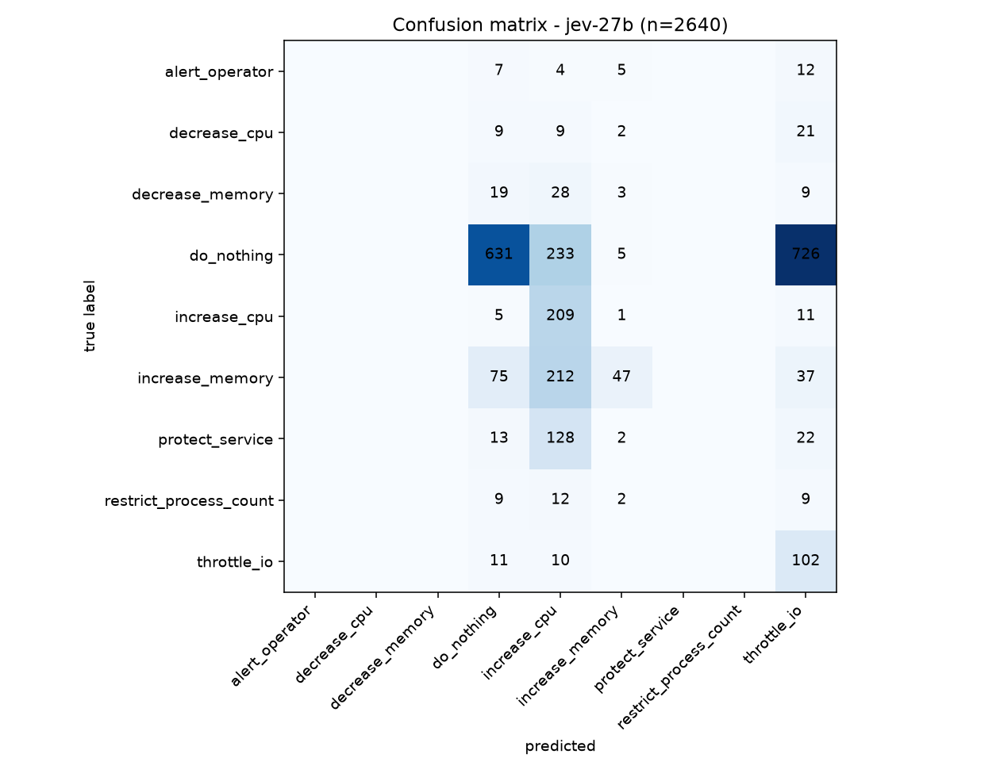
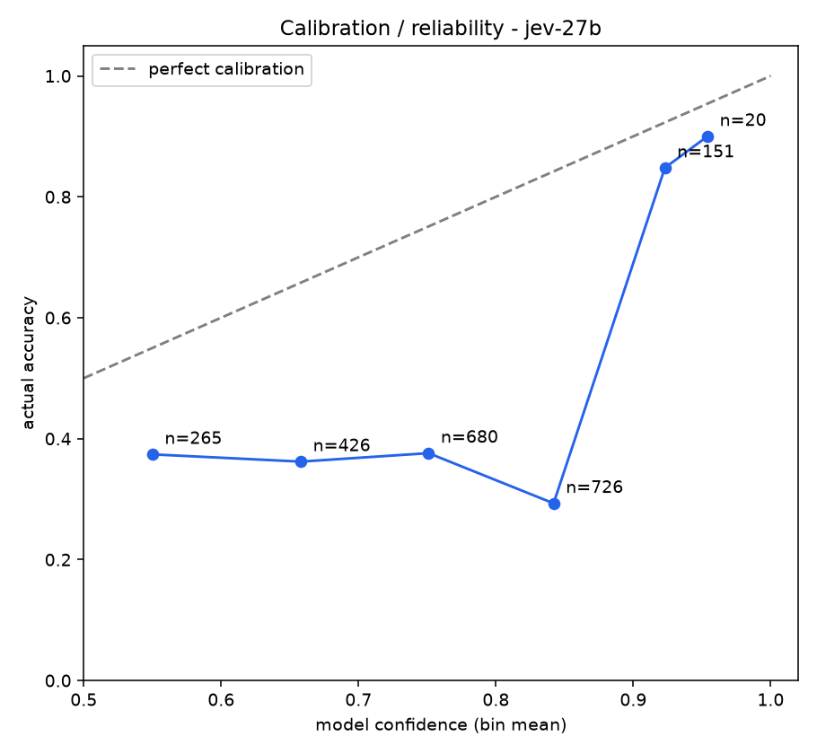
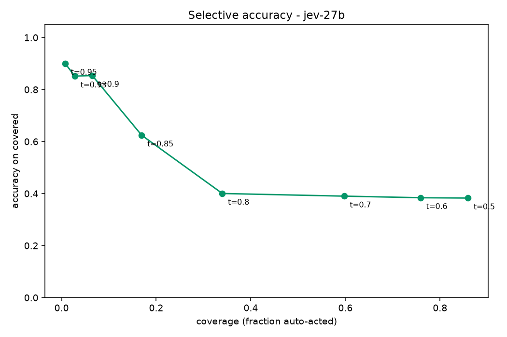
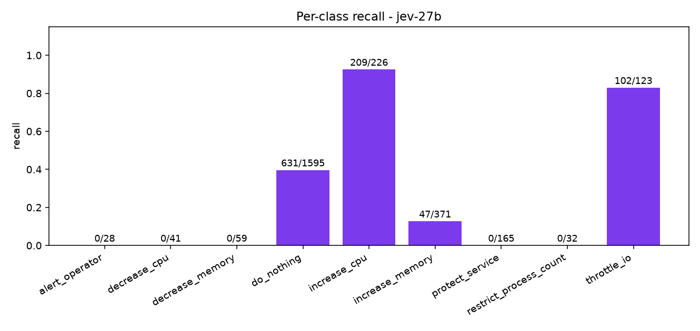
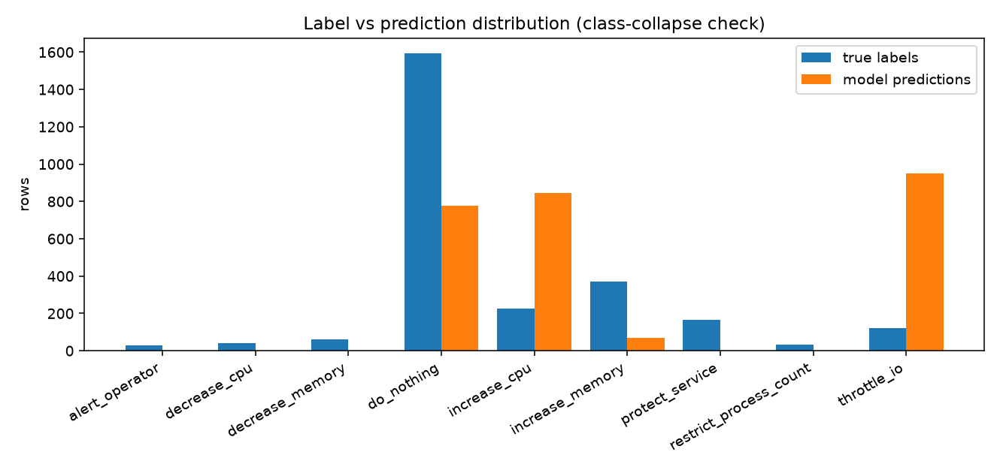

# Evaluation report jev-27b 

## Headline

| metric | value |
|---|---|
| **accuracy** | **37.5%** (989/2640) |
| **macro-F1** | **0.1474** |
| balanced accuracy (mean recall) | 0.253 |

## Per-class metrics

| class | support | predicted | precision | recall | F1 |
|---|---|---|---|---|---|
| alert_operator | 28 | 0 | 0.0 | 0.0 | 0.0 |
| decrease_cpu | 41 | 0 | 0.0 | 0.0 | 0.0 |
| decrease_memory | 59 | 0 | 0.0 | 0.0 | 0.0 |
| do_nothing | 1595 | 779 | 0.81 | 0.396 | 0.532 |
| increase_cpu | 226 | 845 | 0.247 | 0.925 | 0.39 |
| increase_memory | 371 | 67 | 0.701 | 0.127 | 0.215 |
| protect_service | 165 | 0 | 0.0 | 0.0 | 0.0 |
| restrict_process_count | 32 | 0 | 0.0 | 0.0 | 0.0 |
| throttle_io | 123 | 949 | 0.107 | 0.829 | 0.19 |

## Calibration bands

| confidence band | n | mean conf | actual accuracy |
|---|---|---|---|
| 0.50-0.60 | 265 | 0.55 | 0.374 |
| 0.60-0.70 | 426 | 0.658 | 0.362 |
| 0.70-0.80 | 680 | 0.751 | 0.376 |
| 0.80-0.90 | 726 | 0.842 | 0.293 |
| 0.90-0.95 | 151 | 0.923 | 0.848 |
| 0.95-1.00 | 20 | 0.954 | 0.9 |

## Graphs

## Mistakes (most confidently wrong first, top 30)

| row | true | predicted | confidence |
|---|---|---|---|
| 2043-115 | alert_operator | do_nothing | 0.9529 |
| 2031-92 | alert_operator | do_nothing | 0.9521 |
| 2007-26 | throttle_io | do_nothing | 0.9482 |
| 3031-108 | do_nothing | throttle_io | 0.9474 |
| 2039-107 | do_nothing | throttle_io | 0.9464 |
| 3023-12 | restrict_process_count | do_nothing | 0.9455 |
| 2015-14 | increase_cpu | throttle_io | 0.9438 |
| 2027-12 | increase_cpu | throttle_io | 0.9391 |
| 2007-35 | decrease_cpu | do_nothing | 0.9374 |
| 3023-25 | throttle_io | do_nothing | 0.9365 |
| 2007-23 | decrease_memory | do_nothing | 0.933 |
| 2047-47 | increase_memory | increase_cpu | 0.93 |
| 2047-51 | increase_memory | increase_cpu | 0.9278 |
| 2047-53 | increase_memory | increase_cpu | 0.9249 |
| 2047-50 | increase_memory | increase_cpu | 0.9234 |
| 2047-49 | increase_memory | increase_cpu | 0.9224 |
| 2047-46 | increase_memory | increase_cpu | 0.9196 |
| 3027-13 | increase_cpu | throttle_io | 0.9191 |
| 2047-48 | increase_memory | increase_cpu | 0.919 |
| 2047-52 | increase_memory | increase_cpu | 0.9189 |
| 2035-13 | increase_cpu | throttle_io | 0.9134 |
| 2007-19 | increase_memory | do_nothing | 0.9059 |
| 3003-73 | do_nothing | throttle_io | 0.904 |
| 3007-69 | do_nothing | throttle_io | 0.9027 |
| 2007-13 | restrict_process_count | do_nothing | 0.9017 |
| 2007-85 | increase_memory | increase_cpu | 0.8984 |
| 2007-80 | increase_memory | increase_cpu | 0.8973 |
| 2007-81 | increase_memory | increase_cpu | 0.8965 |
| 2055-66 | increase_memory | increase_cpu | 0.8935 |
| 2007-84 | increase_memory | increase_cpu | 0.8918 |