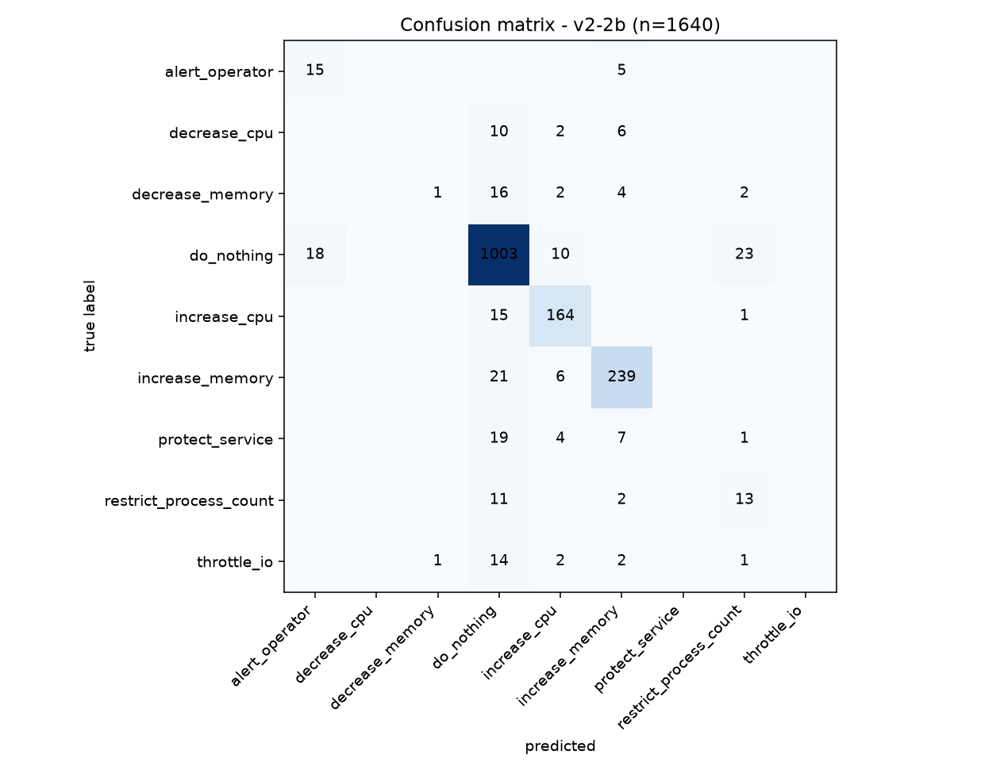
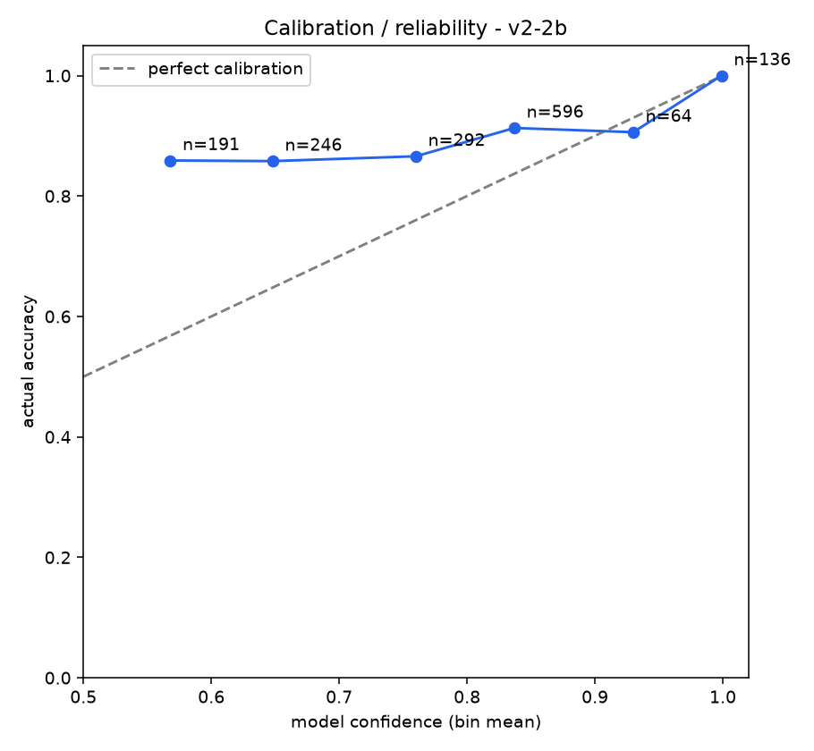
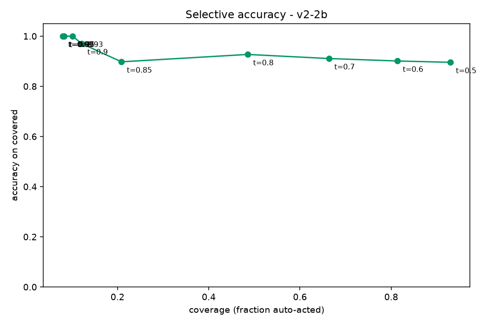
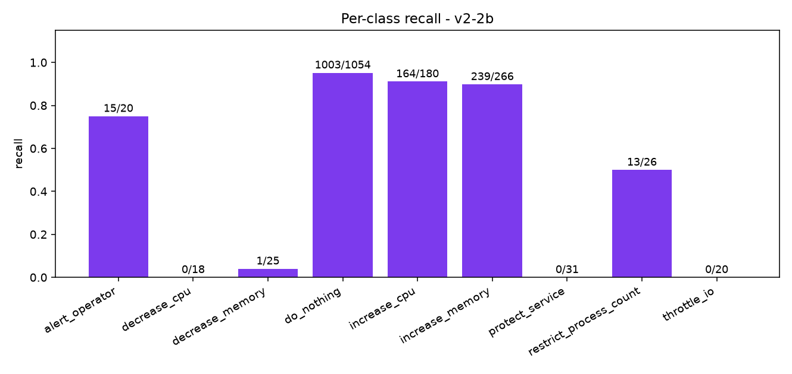
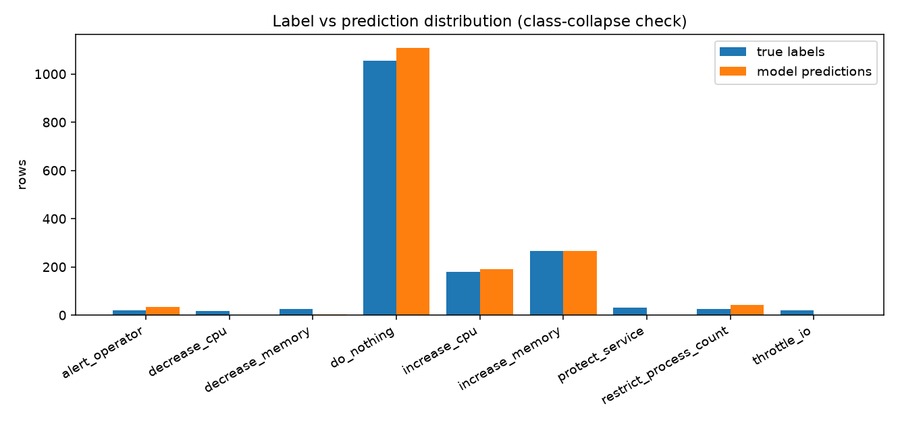

# Evaluation report v2-2b 

## Headline

| metric | value |
|---|---|
| **accuracy** | **87.5%** (1435/1640) |
| **macro-F1** | **0.4157** |
| balanced accuracy (mean recall) | 0.4501 |

## Per-class metrics

| class | support | predicted | precision | recall | F1 |
|---|---|---|---|---|---|
| alert_operator | 20 | 33 | 0.455 | 0.75 | 0.566 |
| decrease_cpu | 18 | 0 | 0.0 | 0.0 | 0.0 |
| decrease_memory | 25 | 2 | 0.5 | 0.04 | 0.074 |
| do_nothing | 1054 | 1109 | 0.904 | 0.952 | 0.927 |
| increase_cpu | 180 | 190 | 0.863 | 0.911 | 0.886 |
| increase_memory | 266 | 265 | 0.902 | 0.898 | 0.9 |
| protect_service | 31 | 0 | 0.0 | 0.0 | 0.0 |
| restrict_process_count | 26 | 41 | 0.317 | 0.5 | 0.388 |
| throttle_io | 20 | 0 | 0.0 | 0.0 | 0.0 |

## Calibration bands

| confidence band | n | mean conf | actual accuracy |
|---|---|---|---|
| 0.50-0.60 | 191 | 0.568 | 0.859 |
| 0.60-0.70 | 246 | 0.648 | 0.858 |
| 0.70-0.80 | 292 | 0.76 | 0.866 |
| 0.80-0.90 | 596 | 0.837 | 0.913 |
| 0.90-0.95 | 64 | 0.93 | 0.906 |
| 0.95-1.00 | 136 | 0.999 | 1.0 |

## Graphs

## Mistakes (most confidently wrong first, top 30)

| row | true | predicted | confidence |
|---|---|---|---|
| 2007-13 | restrict_process_count | do_nothing | 0.9298 |
| 2015-13 | restrict_process_count | do_nothing | 0.9239 |
| 2023-52 | restrict_process_count | do_nothing | 0.9205 |
| 2007-9 | protect_service | do_nothing | 0.9203 |
| 2003-13 | restrict_process_count | do_nothing | 0.9043 |
| 2007-91 | do_nothing | alert_operator | 0.9008 |
| 2003-9 | protect_service | do_nothing | 0.8996 |
| 2043-118 | do_nothing | alert_operator | 0.8961 |
| 2023-96 | do_nothing | alert_operator | 0.891 |
| 2051-98 | do_nothing | alert_operator | 0.891 |
| 2055-120 | do_nothing | alert_operator | 0.8909 |
| 2007-35 | decrease_cpu | do_nothing | 0.8885 |
| 2051-97 | do_nothing | alert_operator | 0.8856 |
| 2047-97 | do_nothing | alert_operator | 0.8856 |
| 2059-128 | do_nothing | alert_operator | 0.8856 |
| 2031-94 | do_nothing | alert_operator | 0.8856 |
| 2039-126 | do_nothing | alert_operator | 0.8856 |
| 2015-91 | do_nothing | alert_operator | 0.8856 |
| 2019-125 | do_nothing | alert_operator | 0.8856 |
| 2003-104 | do_nothing | alert_operator | 0.8856 |
| 2027-121 | do_nothing | alert_operator | 0.8856 |
| 2035-93 | do_nothing | alert_operator | 0.88 |
| 2043-117 | do_nothing | alert_operator | 0.88 |
| 2047-98 | do_nothing | alert_operator | 0.88 |
| 2011-108 | do_nothing | alert_operator | 0.88 |
| 2007-23 | decrease_memory | do_nothing | 0.8775 |
| 2055-24 | throttle_io | do_nothing | 0.8758 |
| 2007-19 | increase_memory | do_nothing | 0.8747 |
| 2015-19 | increase_memory | do_nothing | 0.8698 |
| 2055-17 | increase_memory | do_nothing | 0.869 |