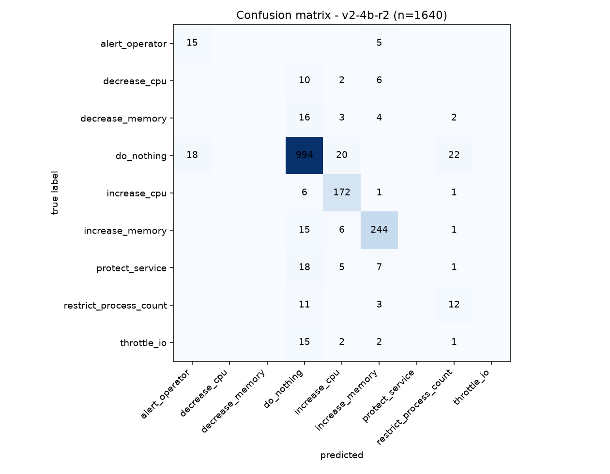
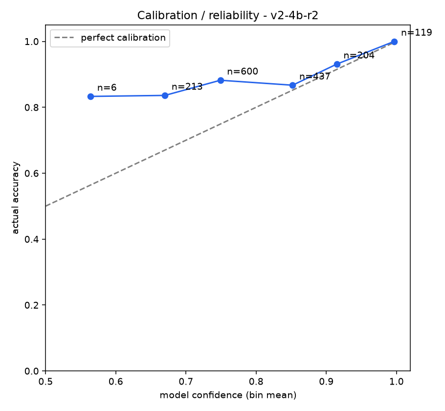
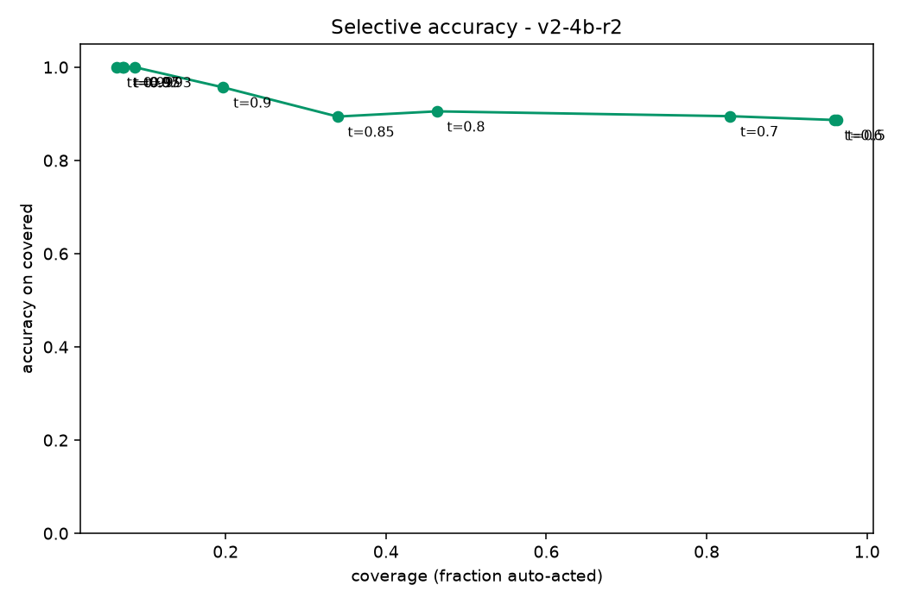
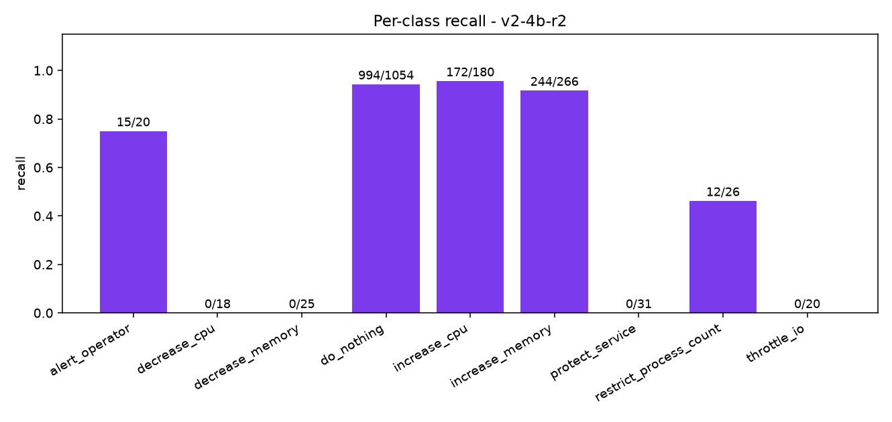
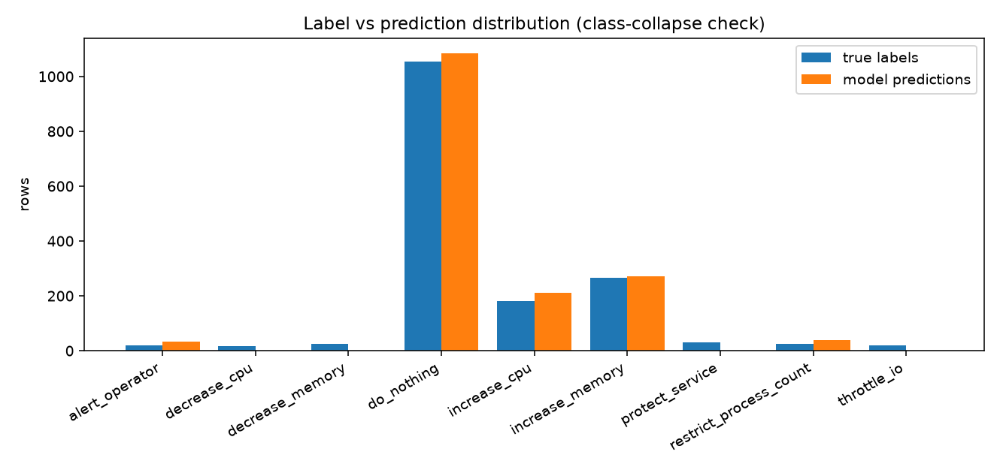

# Evaluation report v2-4b-r2 

## Headline

| metric | value |
|---|---|
| **accuracy** | **87.6%** (1437/1640) |
| **macro-F1** | **0.4053** |
| balanced accuracy (mean recall) | 0.4476 |

## Per-class metrics

| class | support | predicted | precision | recall | F1 |
|---|---|---|---|---|---|
| alert_operator | 20 | 33 | 0.455 | 0.75 | 0.566 |
| decrease_cpu | 18 | 0 | 0.0 | 0.0 | 0.0 |
| decrease_memory | 25 | 0 | 0.0 | 0.0 | 0.0 |
| do_nothing | 1054 | 1085 | 0.916 | 0.943 | 0.929 |
| increase_cpu | 180 | 210 | 0.819 | 0.956 | 0.882 |
| increase_memory | 266 | 272 | 0.897 | 0.917 | 0.907 |
| protect_service | 31 | 0 | 0.0 | 0.0 | 0.0 |
| restrict_process_count | 26 | 40 | 0.3 | 0.462 | 0.364 |
| throttle_io | 20 | 0 | 0.0 | 0.0 | 0.0 |

## Calibration bands

| confidence band | n | mean conf | actual accuracy |
|---|---|---|---|
| 0.50-0.60 | 6 | 0.564 | 0.833 |
| 0.60-0.70 | 213 | 0.67 | 0.836 |
| 0.70-0.80 | 600 | 0.749 | 0.882 |
| 0.80-0.90 | 437 | 0.852 | 0.867 |
| 0.90-0.95 | 204 | 0.915 | 0.931 |
| 0.95-1.00 | 119 | 0.997 | 1.0 |

## Graphs

## Mistakes (most confidently wrong first, top 30)

| row | true | predicted | confidence |
|---|---|---|---|
| 2007-13 | restrict_process_count | do_nothing | 0.9292 |
| 2023-52 | restrict_process_count | do_nothing | 0.9284 |
| 2007-9 | protect_service | do_nothing | 0.9211 |
| 2043-12 | restrict_process_count | increase_memory | 0.9164 |
| 2043-30 | protect_service | increase_memory | 0.912 |
| 2039-7 | protect_service | increase_memory | 0.9117 |
| 2043-34 | decrease_cpu | increase_memory | 0.9082 |
| 2043-8 | protect_service | increase_memory | 0.9072 |
| 2043-22 | decrease_memory | increase_memory | 0.9045 |
| 2015-91 | do_nothing | alert_operator | 0.9038 |
| 2039-21 | decrease_memory | increase_memory | 0.903 |
| 2039-11 | restrict_process_count | increase_memory | 0.9022 |
| 2055-70 | protect_service | increase_memory | 0.901 |
| 2015-9 | protect_service | do_nothing | 0.9007 |
| 2023-96 | do_nothing | alert_operator | 0.8992 |
| 2003-104 | do_nothing | alert_operator | 0.8991 |
| 2043-118 | do_nothing | alert_operator | 0.899 |
| 2039-126 | do_nothing | alert_operator | 0.8989 |
| 2019-125 | do_nothing | alert_operator | 0.8988 |
| 2011-108 | do_nothing | alert_operator | 0.8987 |
| 2055-120 | do_nothing | alert_operator | 0.8986 |
| 2027-121 | do_nothing | alert_operator | 0.8981 |
| 2035-82 | alert_operator | increase_memory | 0.8962 |
| 2031-94 | do_nothing | alert_operator | 0.894 |
| 2051-98 | do_nothing | alert_operator | 0.894 |
| 2047-97 | do_nothing | alert_operator | 0.894 |
| 2047-98 | do_nothing | alert_operator | 0.8939 |
| 2035-93 | do_nothing | alert_operator | 0.8938 |
| 2051-97 | do_nothing | alert_operator | 0.8938 |
| 2039-33 | decrease_cpu | increase_memory | 0.8937 |