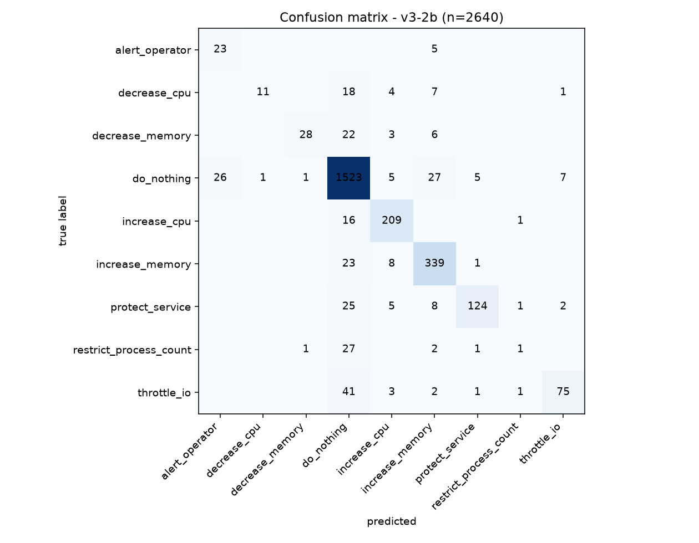
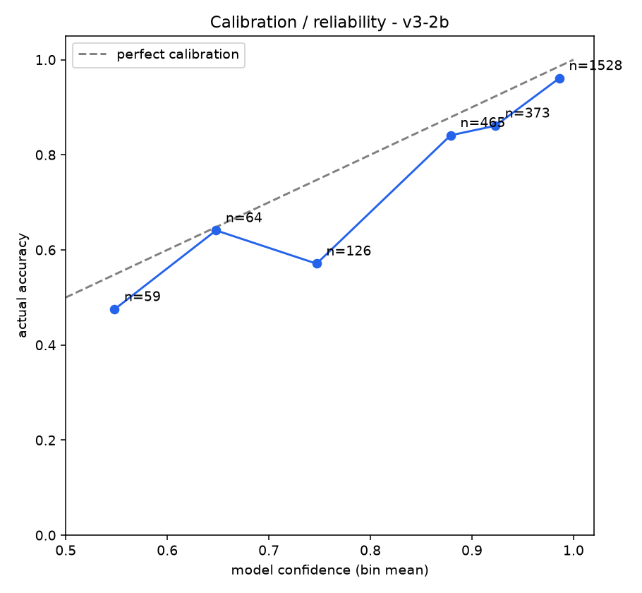
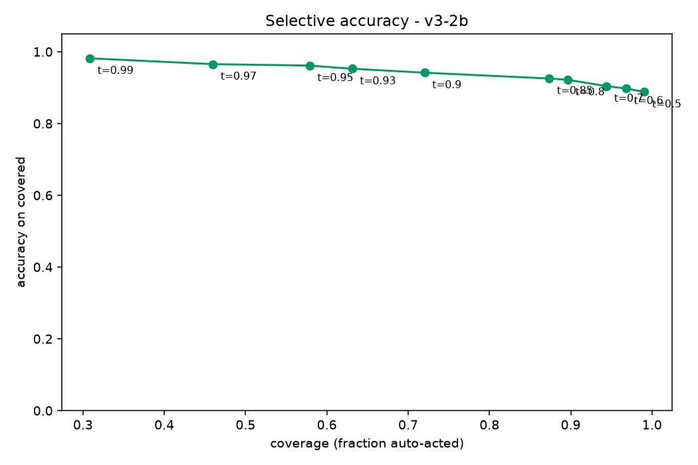
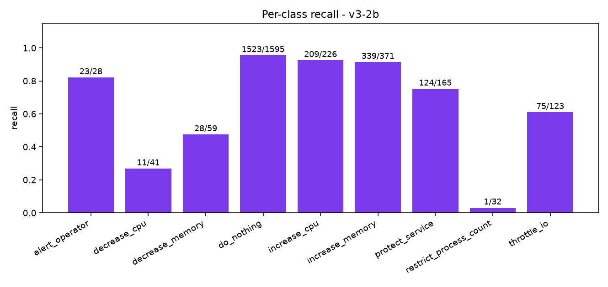
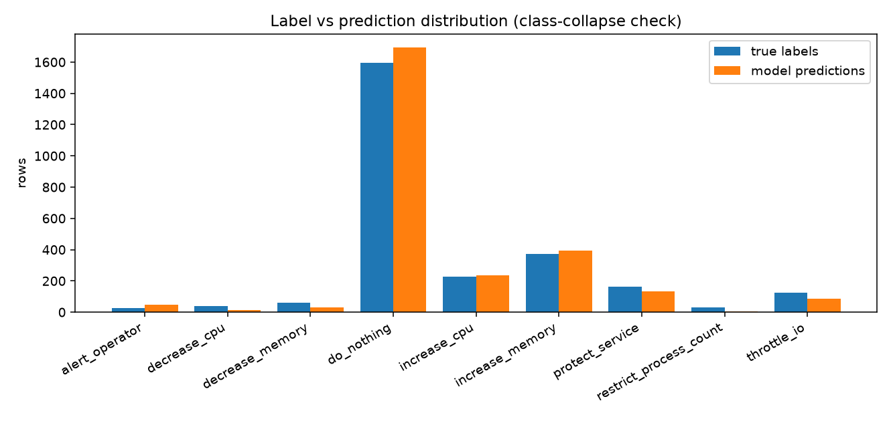

# Evaluation report v3-2b 

## Headline

| metric | value |
|---|---|
| base model | 67.7% |
| **accuracy** | **88.4%** (2333/2640) |
| **macro-F1** | **0.6629** |
| balanced accuracy (mean recall) | 0.639 |

## Per-class metrics

| class | support | predicted | precision | recall | F1 |
|---|---|---|---|---|---|
| alert_operator | 28 | 49 | 0.469 | 0.821 | 0.597 |
| decrease_cpu | 41 | 12 | 0.917 | 0.268 | 0.415 |
| decrease_memory | 59 | 30 | 0.933 | 0.475 | 0.629 |
| do_nothing | 1595 | 1695 | 0.899 | 0.955 | 0.926 |
| increase_cpu | 226 | 237 | 0.882 | 0.925 | 0.903 |
| increase_memory | 371 | 396 | 0.856 | 0.914 | 0.884 |
| protect_service | 165 | 132 | 0.939 | 0.752 | 0.835 |
| restrict_process_count | 32 | 4 | 0.25 | 0.031 | 0.056 |
| throttle_io | 123 | 85 | 0.882 | 0.61 | 0.721 |

## Calibration bands

| confidence band | n | mean conf | actual accuracy |
|---|---|---|---|
| 0.50-0.60 | 59 | 0.548 | 0.475 |
| 0.60-0.70 | 64 | 0.648 | 0.641 |
| 0.70-0.80 | 126 | 0.747 | 0.571 |
| 0.80-0.90 | 465 | 0.879 | 0.841 |
| 0.90-0.95 | 373 | 0.923 | 0.861 |
| 0.95-1.00 | 1528 | 0.986 | 0.961 |

## Graphs

## Mistakes (most confidently wrong first, top 30)

| row | true | predicted | confidence |
|---|---|---|---|
| 3015-49 | throttle_io | do_nothing | 0.9994 |
| 3023-25 | throttle_io | do_nothing | 0.9981 |
| 3023-12 | restrict_process_count | do_nothing | 0.9978 |
| 2035-12 | restrict_process_count | do_nothing | 0.9977 |
| 3023-95 | throttle_io | protect_service | 0.9965 |
| 2015-13 | restrict_process_count | do_nothing | 0.995 |
| 2055-11 | restrict_process_count | do_nothing | 0.9941 |
| 2023-52 | restrict_process_count | do_nothing | 0.9933 |
| 3019-6 | do_nothing | increase_memory | 0.9928 |
| 2027-21 | decrease_memory | do_nothing | 0.9918 |
| 2027-33 | decrease_cpu | do_nothing | 0.9917 |
| 3023-34 | decrease_cpu | increase_memory | 0.9916 |
| 2027-17 | increase_memory | do_nothing | 0.9915 |
| 2007-13 | restrict_process_count | do_nothing | 0.9912 |
| 3023-33 | decrease_memory | increase_memory | 0.9904 |
| 2007-9 | protect_service | do_nothing | 0.9896 |
| 2027-36 | throttle_io | do_nothing | 0.9875 |
| 2027-38 | protect_service | do_nothing | 0.9874 |
| 2007-35 | decrease_cpu | do_nothing | 0.9874 |
| 3023-8 | protect_service | increase_memory | 0.9873 |
| 3031-8 | protect_service | do_nothing | 0.9866 |
| 2043-22 | decrease_memory | increase_memory | 0.9859 |
| 3031-12 | restrict_process_count | do_nothing | 0.9853 |
| 3027-18 | increase_memory | do_nothing | 0.9848 |
| 2055-112 | protect_service | do_nothing | 0.9836 |
| 2043-30 | protect_service | increase_memory | 0.9834 |
| 2043-12 | restrict_process_count | increase_memory | 0.983 |
| 2003-13 | restrict_process_count | do_nothing | 0.9829 |
| 2043-34 | decrease_cpu | increase_memory | 0.9828 |
| 2003-9 | protect_service | do_nothing | 0.9824 |