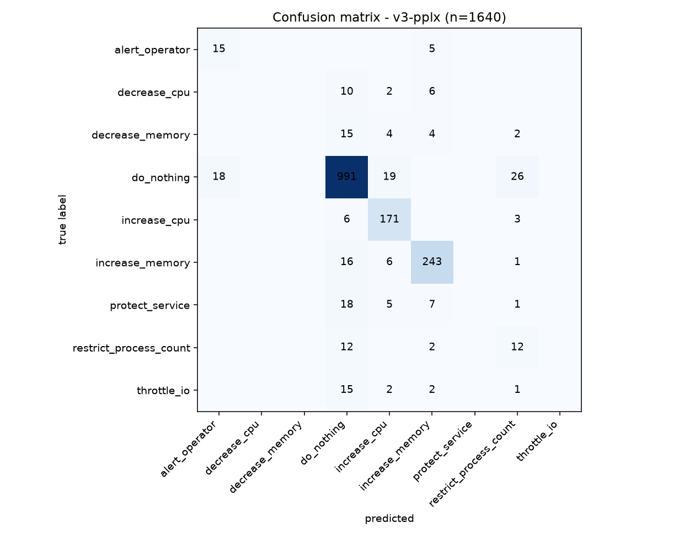
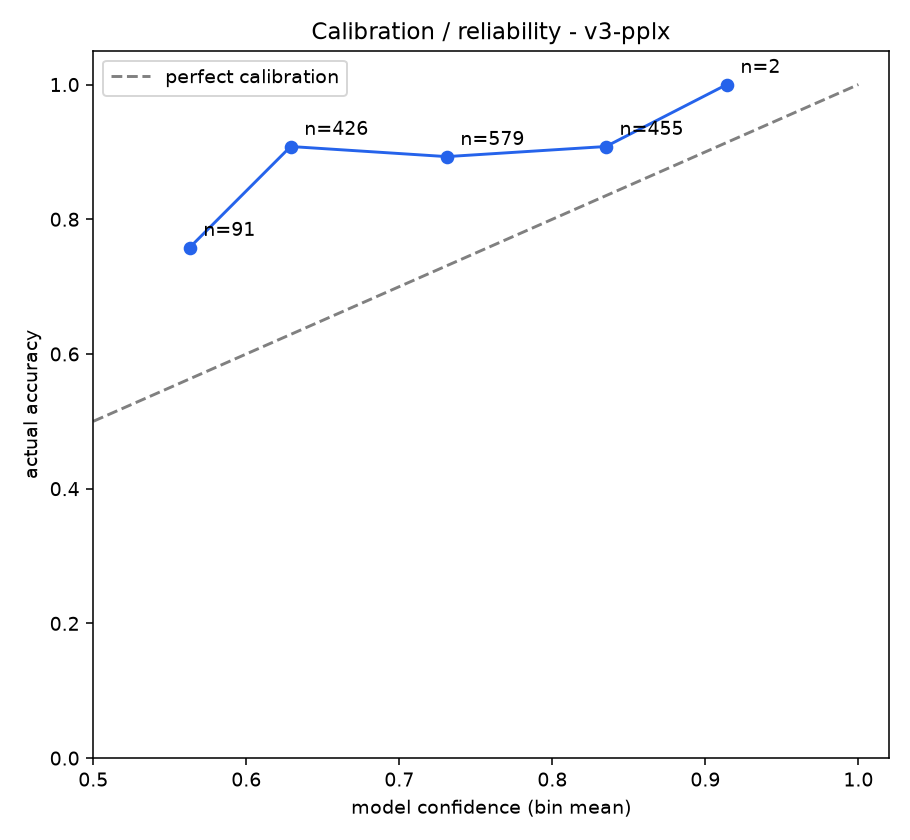
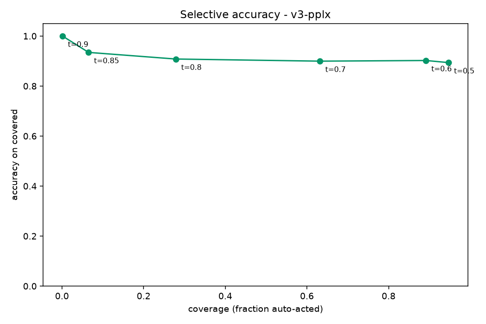
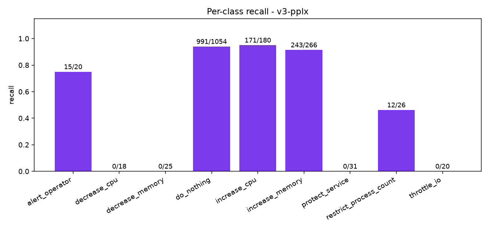
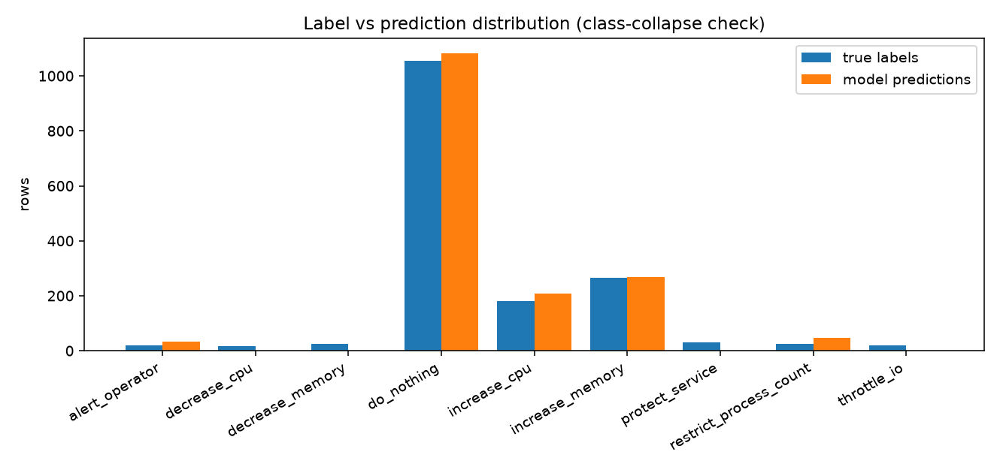

# Evaluation report v3-pplx 

## Headline

| metric | value |
|---|---|
| **accuracy** | **87.3%** (1432/1640) |
| **macro-F1** | **0.4014** |
| balanced accuracy (mean recall) | 0.4462 |

## Per-class metrics

| class | support | predicted | precision | recall | F1 |
|---|---|---|---|---|---|
| alert_operator | 20 | 33 | 0.455 | 0.75 | 0.566 |
| decrease_cpu | 18 | 0 | 0.0 | 0.0 | 0.0 |
| decrease_memory | 25 | 0 | 0.0 | 0.0 | 0.0 |
| do_nothing | 1054 | 1083 | 0.915 | 0.94 | 0.927 |
| increase_cpu | 180 | 209 | 0.818 | 0.95 | 0.879 |
| increase_memory | 266 | 269 | 0.903 | 0.914 | 0.908 |
| protect_service | 31 | 0 | 0.0 | 0.0 | 0.0 |
| restrict_process_count | 26 | 46 | 0.261 | 0.462 | 0.333 |
| throttle_io | 20 | 0 | 0.0 | 0.0 | 0.0 |

## Calibration bands

| confidence band | n | mean conf | actual accuracy |
|---|---|---|---|
| 0.50-0.60 | 91 | 0.563 | 0.758 |
| 0.60-0.70 | 426 | 0.629 | 0.908 |
| 0.70-0.80 | 579 | 0.731 | 0.893 |
| 0.80-0.90 | 455 | 0.835 | 0.908 |
| 0.90-0.95 | 2 | 0.914 | 1.0 |

## Graphs

## Mistakes (most confidently wrong first, top 30)

| row | true | predicted | confidence |
|---|---|---|---|
| 2031-10 | do_nothing | increase_cpu | 0.8732 |
| 2043-22 | decrease_memory | increase_memory | 0.8551 |
| 2035-42 | increase_memory | increase_cpu | 0.8532 |
| 2027-61 | decrease_memory | increase_cpu | 0.8527 |
| 2027-94 | throttle_io | increase_cpu | 0.8516 |
| 2039-126 | do_nothing | alert_operator | 0.8511 |
| 2027-112 | protect_service | increase_cpu | 0.8509 |
| 2031-18 | increase_memory | increase_cpu | 0.8499 |
| 2019-125 | do_nothing | alert_operator | 0.8495 |
| 2027-105 | increase_memory | increase_cpu | 0.8486 |
| 2027-59 | decrease_cpu | increase_cpu | 0.8485 |
| 2027-76 | increase_memory | increase_cpu | 0.846 |
| 2003-23 | decrease_memory | increase_cpu | 0.845 |
| 2039-21 | decrease_memory | increase_memory | 0.8439 |
| 2055-33 | decrease_cpu | increase_cpu | 0.8425 |
| 2003-19 | increase_memory | increase_cpu | 0.8424 |
| 2055-120 | do_nothing | alert_operator | 0.8422 |
| 2055-41 | increase_memory | increase_cpu | 0.8415 |
| 2055-38 | protect_service | increase_cpu | 0.8398 |
| 2027-70 | protect_service | increase_cpu | 0.8394 |
| 2043-12 | restrict_process_count | increase_memory | 0.8363 |
| 2007-72 | protect_service | increase_memory | 0.8355 |
| 2039-33 | decrease_cpu | increase_memory | 0.8355 |
| 2039-11 | restrict_process_count | increase_memory | 0.8354 |
| 2043-25 | throttle_io | increase_memory | 0.8266 |
| 2039-7 | protect_service | increase_memory | 0.8255 |
| 2003-15 | do_nothing | increase_cpu | 0.8252 |
| 2003-72 | protect_service | increase_memory | 0.8209 |
| 2043-8 | protect_service | increase_memory | 0.8207 |
| 2035-83 | alert_operator | increase_memory | 0.8194 |