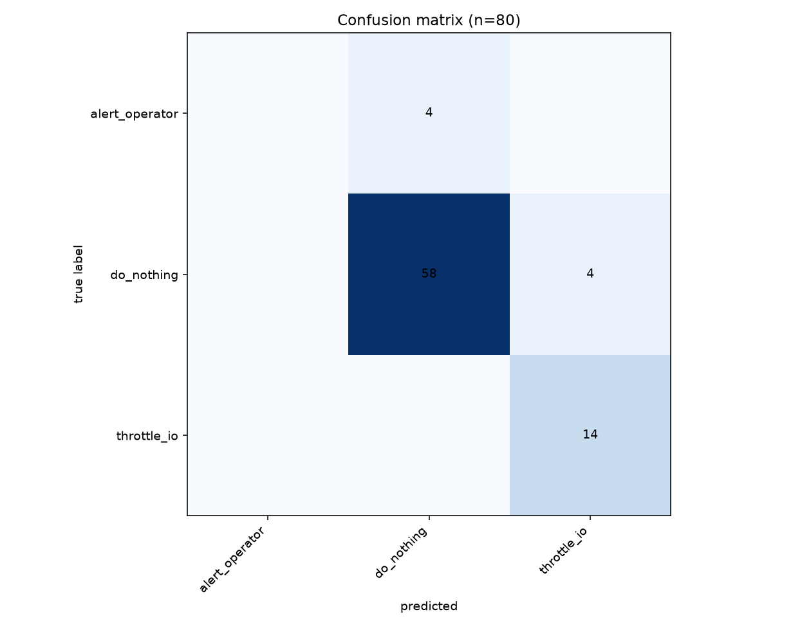
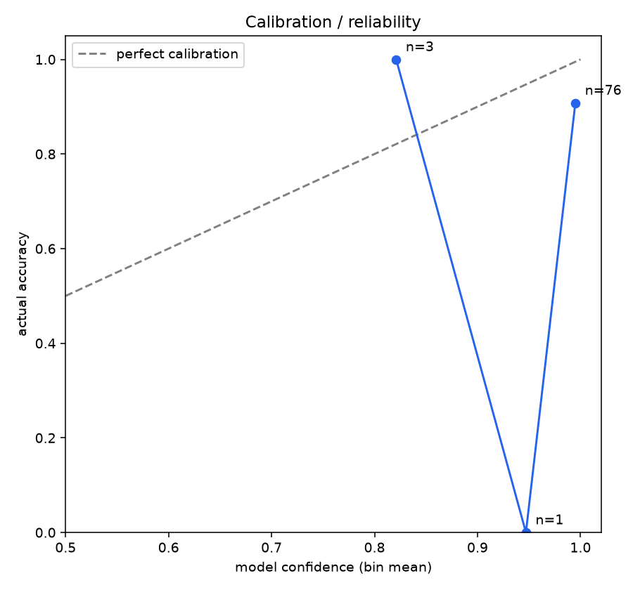
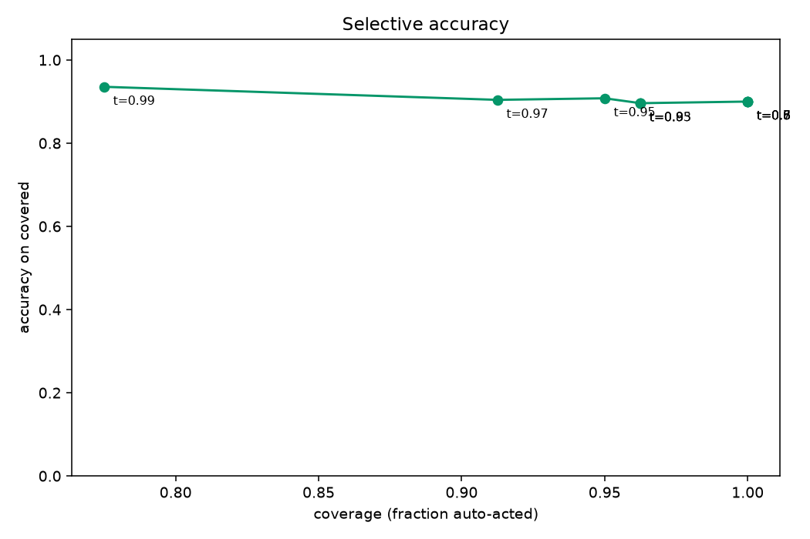
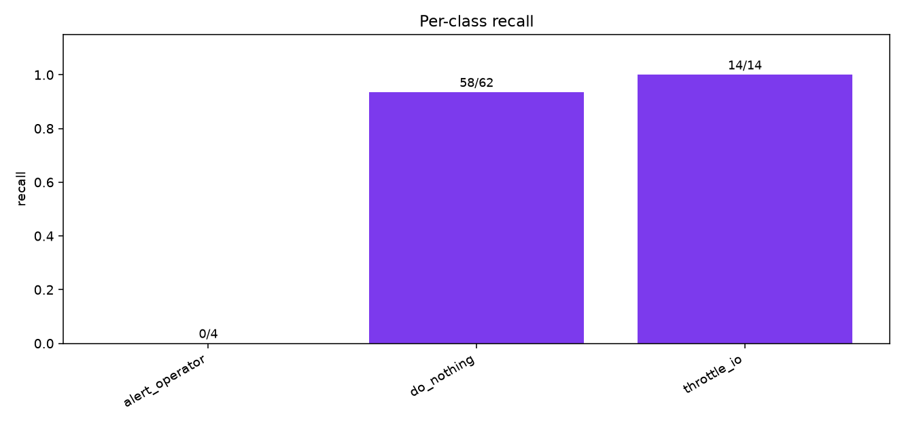
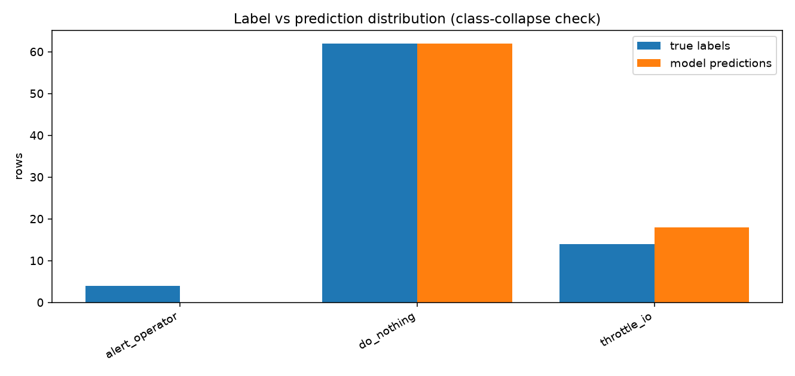

# Evaluation report (pilot) 

## Headline

| metric | value |
|---|---|
| base model | 77.5% |
| **accuracy** | **90.0%** (72/80) |
| **macro-F1** | **0.6033** |
| balanced accuracy (mean recall) | 0.645 |

## Per-class metrics

| class | support | predicted | precision | recall | F1 |
|---|---|---|---|---|---|
| alert_operator | 4 | 0 | 0.0 | 0.0 | 0.0 |
| do_nothing | 62 | 62 | 0.935 | 0.935 | 0.935 |
| throttle_io | 14 | 18 | 0.778 | 1.0 | 0.875 |

## Calibration bands

| confidence band | n | mean conf | actual accuracy |
|---|---|---|---|
| 0.80-0.90 | 3 | 0.821 | 1.0 |
| 0.90-0.95 | 1 | 0.947 | 0.0 |
| 0.95-1.00 | 76 | 0.995 | 0.908 |

## Graphs

## Mistakes (most confidently wrong first, top 30)

| row | true | predicted | confidence |
|---|---|---|---|
| 2026-10-14T19:53:42.295Z-172 | alert_operator | do_nothing | 0.9994 |
| 2026-10-14T19:54:42.330Z-202 | alert_operator | do_nothing | 0.9992 |
| 2026-10-14T19:43:47.407Z-202 | alert_operator | do_nothing | 0.9991 |
| 2026-10-14T19:42:47.373Z-172 | alert_operator | do_nothing | 0.9986 |
| 2026-10-14T19:42:41.371Z-169 | do_nothing | throttle_io | 0.9731 |
| 2026-10-14T19:42:43.372Z-170 | do_nothing | throttle_io | 0.9731 |
| 2026-10-14T19:42:39.370Z-168 | do_nothing | throttle_io | 0.9717 |
| 2026-10-14T19:42:45.373Z-171 | do_nothing | throttle_io | 0.9475 |